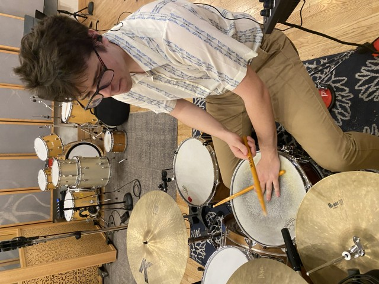

---
# Feel free to add content and custom Front Matter to this file.
# To modify the layout, see https://jekyllrb.com/docs/themes/#overriding-theme-defaults

layout: home
stylesheets: home
---

Nic Butakow is a drummer based in Sarasota, FL with nearly a decade of professional experience. He served as the lead drummer for the University of Florida Jazz Band and features prominently on their newly released studio album.

Nic performs, writes, and records with Tampa-based punk-adjacent indie rock band Truth Value and several acts based in Gainesville: jazz fusion collective Atbash, jazz pop singer-songwriter Memo, and neo-soul singer-songwriter Solmei. He has performed and recorded as a drummer or percussionist with numerous other groups including concert bands, orchestras, choirs, and an Afropop ensemble.

As a bandleader, Nic spent a year leading the Swazz Band, a jazz combo comprised of UF students featuring multiple vocalists and a tap dancer. He performed with the group at TEDxUF, a national dance competition, a wedding, and on a parade float.

In the pit, Nic played percussion for the UF School of Theatre + Dance's 2025 production of *Rent*, and he performed on stage as the drummer Schlatko in an independent production of *Hedwig and the Angry Inch* in 2026.

Outside of music, Nic is pursuing a career in information technology. He graduated from UF in 2025 with B.S. degrees in Computer Science and Mathematics.
